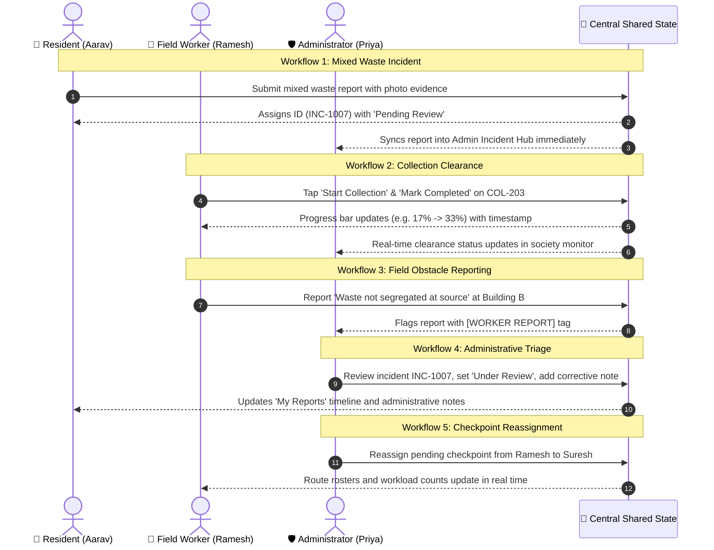

# SegreTrack

> **"From Household Segregation to Responsible Collection."**

[](https://react.dev/)
[](https://www.typescriptlang.org/)
[](https://vitejs.dev/)
[](https://tailwindcss.com/)
[](#)

---

## 1. Project Overview

**SegreTrack** is an academic design-thinking civic-tech platform designed to eliminate the systemic breakdown where properly segregated household waste is mixed during collection.

While households conscientiously separate kitchen organics from clean dry packaging, waste streams are frequently recombined into a single pushcart or municipal truck due to lack of coordination, missing accountability, and absence of an actionable feedback loop.

SegreTrack provides a unified, transparent coordination platform connecting three key stakeholders:
1. **Residents**: Follow verified segregation guidance, view collection timetables, and report waste mixing with photographic evidence.
2. **Collection Workers**: Execute assigned routes, mark checkpoints as started/completed in real time, and report field obstacles (e.g., contaminated source bins, blocked ramps).
3. **Society Administrators**: Monitor society-wide collection clearance, triage incidents, assign corrective actions, dynamically reassign checkpoints, and identify recurring contamination hotspots.

> **Note on Scope**: This is an academic design-thinking prototype built entirely on the frontend. It operates with realistic client-side sample data, reactive state synchronization across all roles, and browser `localStorage` persistence. No external API keys, backend databases, or hardware sensors are required.

---

## 2. Interactive Role Dashboards & Routes

SegreTrack includes a public civic landing page and three role-specific dashboards. Any role can be accessed immediately without authentication via the **Top Demo Environment Switcher**:

| Role / Route | Persona Profile | Key Responsibilities |
|---|---|---|
| **Public Landing Page** (`#/` or `/`) | *General Visitor* | Explains the 3 real-world breakdowns, showcases the 3-step lifecycle, and provides direct role card entries. |
| **Resident Portal** (`#/resident`) | **Aarav Sharma**<br>*Building A, Flat 204* | Today's collection timetable, 3-stream waste segregation encyclopedia, photographic mixed-waste reporting, and personal report tracking with resolution timelines. |
| **Worker Portal** (`#/worker`) | **Ramesh Patil**<br>*Sector 1 (Blocks A, B, C)* | Field-optimized interface with live route completion progress bar (% & counts), one-tap start/complete collection actions, and operational issue logging. |
| **Society Admin Dashboard** (`#/admin`) | **Priya Deshmukh**<br>*Society Facility Director* | Live society-wide collection tracking, incident triage and corrective action hub, rule-based **Recurring Hotspot Detection** (Building B), Recharts analytics, and staff checkpoint reassignment. |

---

## 3. The 5 Core Demonstration Workflows

The application implements five end-to-end interactive workflows across roles:



---

## 4. Key Architectural Features

### 🟢 3-Stream Segregation Directory
Searchable encyclopedia covering kitchen organics, dry packaging, and hazardous items (household batteries, CFL tubes, electronic cables) with explicit municipal Do's & Don'ts.

### ⚠️ Photographic Incident Reporting
Validated forms supporting custom photo uploads (Data URL) or one-click preset test photos. Generates tracking IDs (`INC-10xx`) and auto-populates resolution timelines.

### 🔥 Deterministic Recurring Hotspot Detection
Rule-based aggregation groups incidents by location and frequency. For example, repeated mixing at **Building B** automatically triggers a priority hotspot flag with tailored follow-up recommendations (e.g., dual-chute divider signage & staff briefings) without black-box AI claims.

### 📊 Interactive Recharts Analytics
Dynamic data visualizations generated from live state:
- Collection clearance by building (Completed vs. In Progress vs. Pending)
- Incident categorization breakdown (Donut / Pie chart)
- Incident distribution by location (Horizontal bar chart)
- Waste stream verification volume (Wet vs. Dry vs. Special)

### 🔄 Demo Environment & Data Reset
A persistent top banner provides:
- Instant 1-click role switching between Public, Resident, Worker, and Admin.
- A **"Reset Data"** button with a confirmation modal that restores the default 10 collections, 6 incidents, and audit trails.

---

## 5. Visual Design System

The visual design follows modern civic-tech design principles prioritizing contrast, clarity, and trust:

- **Primary Forest Green**: `#174C3C` (Primary actions, top branding)
- **Deep Green**: `#10382D` (Hero banners, headers)
- **Fresh Green**: `#43A879` (Verified statuses, positive trends)
- **Soft Mint**: `#E7F4EC` (Badges, subtle card accents)
- **Warm Off-White**: `#F8FAF7` (Canvas background)
- **Warning Amber**: `#D99125` (Pending triage, review warnings)
- **Error Red**: `#D9534F` (Incidents, severe non-compliance)
- **Information Blue**: `#3977C3` (In-progress operations, dry recyclables)
- **Typography**: Inter / Plus Jakarta Sans sans-serif hierarchy

---

## 6. Directory Structure

```
DT/
├── index.html                    # SEO metadata, Inter fonts, SVG favicon
├── package.json                  # Dependencies & scripts
├── tsconfig.app.json             # TypeScript compiler settings
├── vite.config.ts                # Vite 6 + React + Tailwind v4 configuration
├── public/
│   └── leaf.svg                  # Brand favicon mark
└── src/
    ├── types/
    │   └── index.ts              # TypeScript domain models (Collection, Incident, Role)
    ├── data/
    │   └── initialData.ts        # Sample collections, incidents, workers, waste guide
    ├── context/
    │   └── SegreTrackContext.tsx # Centralized reactive state & localStorage sync
    ├── utils/
    │   └── formatters.ts         # Timestamps & rule-based hotspot algorithms
    ├── components/
    │   ├── common/
    │   │   ├── Logo.tsx          # Brand leaf mark & wordmark
    │   │   ├── StatCard.tsx      # KPI metric cards
    │   │   ├── StatusBadge.tsx   # Color-coded status badges with icons
    │   │   ├── ConfirmModal.tsx  # Accessible confirmation dialog
    │   │   └── EmptyState.tsx    # Empty list and search feedback
    │   └── layout/
    │       ├── DemoBanner.tsx    # Role switcher & reset data action
    │       ├── AppHeader.tsx     # Dashboard header with notification indicators
    │       ├── AppSidebar.tsx    # Collapsible / mobile navigation sidebar
    │       ├── DashboardLayout.tsx# Responsive drawer & layout wrapper
    │       └── ToastContainer.tsx# Floating notification toasts
    ├── features/
    │   ├── landing/
    │   │   └── LandingPage.tsx   # Public marketing & civic problem overview
    │   ├── resident/
    │   │   ├── ResidentDashboard.tsx
    │   │   ├── CollectionSchedule.tsx
    │   │   ├── WasteGuide.tsx
    │   │   ├── ReportIncidentForm.tsx
    │   │   ├── MyReports.tsx
    │   │   └── IncidentDetailModal.tsx
    │   ├── worker/
    │   │   ├── WorkerDashboard.tsx
    │   │   ├── AssignedCollections.tsx
    │   │   ├── WorkerIssueForm.tsx
    │   │   └── CollectionHistory.tsx
    │   └── admin/
    │       ├── AdminDashboard.tsx
    │       ├── CollectionMonitoring.tsx
    │       ├── IncidentManagement.tsx
    │       ├── RecurringIssues.tsx
    │       ├── CollectionAnalytics.tsx
    │       └── WorkerCoordination.tsx
    ├── App.tsx                   # Hash router & view switcher
    ├── main.tsx                  # React DOM entry point
    └── index.css                 # Tailwind v4 theme & global resets
```

---

## 7. Getting Started

### Prerequisites
- [Node.js](https://nodejs.org/) (v18 or higher recommended)
- `npm` (v9 or higher)

### Installation & Run

1. Clone or navigate to the repository:
   ```bash
   git clone https://github.com/satyajitshinde25/SergeTrack.git
   cd SergeTrack
   ```

2. Install dependencies:
   ```bash
   npm install
   ```

3. Launch the development server:
   ```bash
   npm run dev
   ```
   Open [http://localhost:5173](http://localhost:5173) in your browser.

4. To build for production:
   ```bash
   npm run build
   ```

---

## 8. Academic Presentation Guide

When presenting this prototype:
1. **Start on the Public Landing Page**: Highlight the central problem (*"Segregation Shouldn't Stop at the Bin"*).
2. **Switch to Resident Portal**: Show Aarav Sharma's schedule and search the Waste Guide for *"battery"* to show why hazardous waste is segregated into special drop-offs.
3. **Submit an Incident**: File a report under "Report Issue" for mixed waste with a demo image.
4. **Switch to Worker Portal**: Show Ramesh Patil's route progress bar. Complete a collection to show the timestamp update.
5. **Switch to Admin Dashboard**:
   - Review the newly submitted incident and update its status to `Under Review` with a corrective note.
   - Show the **Recurring Issues** tab highlighting the **Building B Hotspot** with automated recommendations.
   - Show the **Analytics** tab demonstrating live charts.
   - Show **Worker Coordination** and reassign a checkpoint between staff.
6. **Return to Resident Portal**: Demonstrate that the resident's "My Reports" timeline updated in real time.

---

## License & Attribution

Designed and developed as an academic Design-Thinking FA2 project for civic waste coordination and environmental sustainability.
